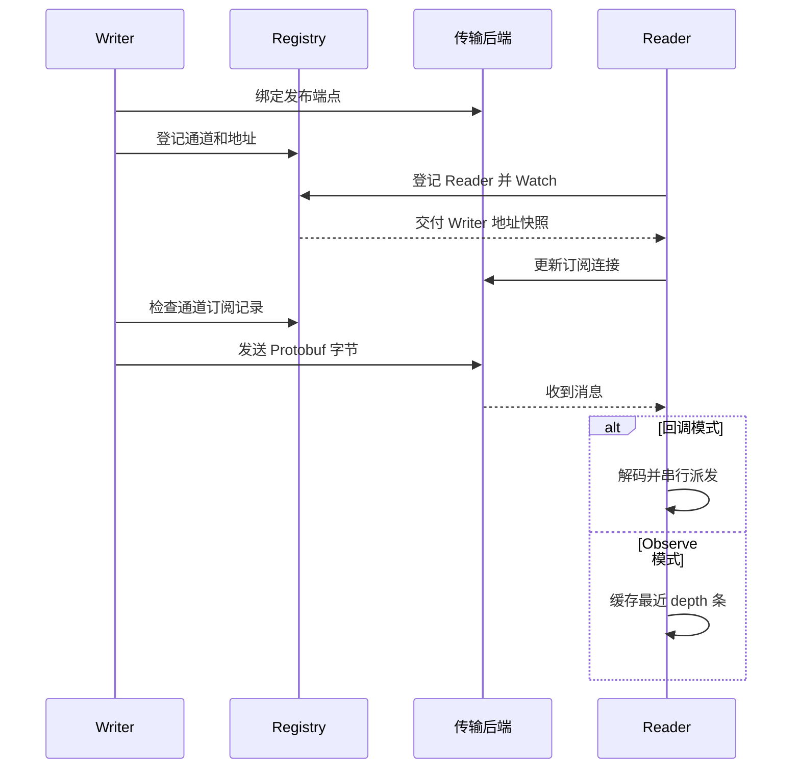
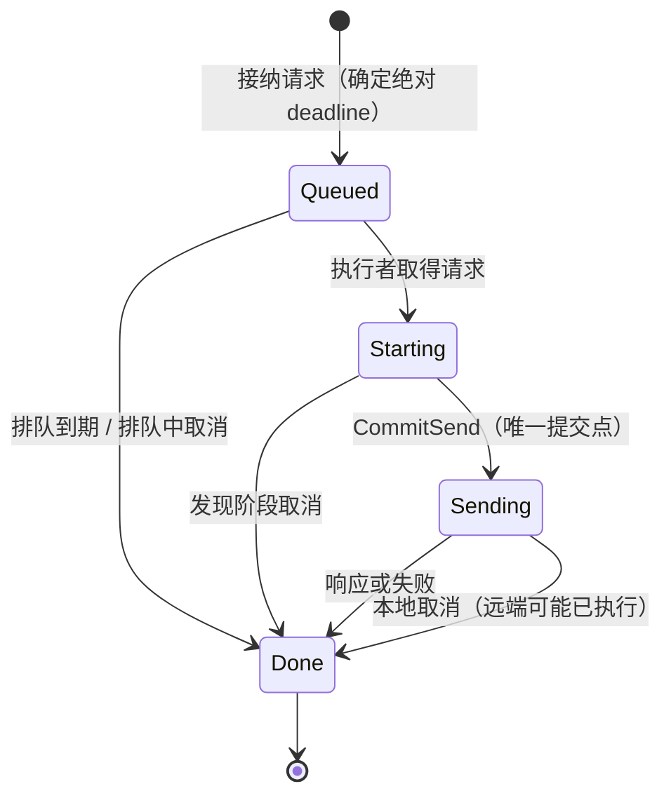

# 行为契约

本文是「现在能不能这样改」的权威依据。每条断言都对应可运行的测试（见附录 A）；无法被代码验证的内容不属于本文，应写入 [known-gaps.md](known-gaps.md) 或 ADR。

## 1. 资源所有权

| 对象 | 所有者 | 停止与释放 |
| --- | --- | --- |
| Node | `CreateNode()` 返回的 `unique_ptr` | 析构时关闭其持有的 Reader，随后释放进程内节点名 |
| Reader | Node 的读者表持有强引用，调用者也可持有 | `DeleteReader()` 在锁内标记删除、锁外停止 Reader，完成后释放名称。回调可在关闭等待期间查询 Node |
| Writer、Service、Client | 调用者持有强引用，Node 仅保存用于查找与查重的弱引用 | 由端点自身 `Shutdown()`、释放最后一个外部引用或对应 `DeleteXxx()` 触发清理 |
| Reader / Service 的 Core | 公开端点持有，启动成功后进入运行期保活 | 每个 Core 持有后端端点与注册句柄；关闭时停止循环、唤醒收发、等待工作线程退出、注销。创建失败时回滚已取得资源 |
| RPC 请求 | Client Core 的队列与请求表管理状态，调用者持有 future/句柄 | 终态只兑现一次。取消句柄通过弱引用定位原 Core；重建客户端后旧句柄无法取消新 Core 的请求 |

节点名在进程内查重。端点名查重以 **Node、端点角色、逻辑名称**为范围。跨进程同名服务可共存。

**并发创建同名端点只有一次成功。** 查重与占位在同一临界区内完成，创建成功后再落表；因此在「查重 → 初始化 → 落表」窗口内到达的同名请求不会一起成功，而是返回 `kDuplicate`。落表前释放占位，落表后名字即可被 `DeleteXxx()` 或最后一个外部引用释放所回收。

**全局 `Shutdown()` 只置标志，不级联关闭端点。** 应用需自行停止端点再调用 `Clear()`；该限制见 [known-gaps.md](known-gaps.md) G7。

## 2. 启动与关停次序

1. `Init()` 引导默认依赖。NNG Registry 在首次发现操作时启动。Writer 与 Service 先取得监听地址再登记，Reader 先独立登记再建立 Watch。Worker 启动失败时，已建立的监听、注册与订阅须回滚。
2. 停止 Reader 或 Service：先阻止接收循环继续运行，调用角色 `Close()` 唤醒阻塞操作，再等待非当前工作线程退出并解除发现关系。若在自身回调线程上触发关闭，跳过等待自身的步骤，循环在回调返回后退出。
3. Client 关闭：停止接纳，以 `kCancelled` 兑现全部排队与在途请求（每条只兑现一次），关闭适配器唤醒仍在 `Exchange` 里的 I/O，再等待执行者退出。关停不等待在途请求自然到期，因此也不受发现查询与传输等待支配。
4. 全局 `Shutdown()` 触发进程级信号；应用用端点级关闭控制已有通信，随后调用 `Clear()`。全局清理重置默认发现并等待已登记的 Reader 与 Service 的在途回调。释放资源后要停止后续派发，应先关闭相应端点。

## 3. 并发与执行位置

| 执行位置 | 约束 |
| --- | --- |
| Reader / Service 自有线程 | 同一端点回调串行。业务异常在 Reader 记日志，在 Service 映射为服务失败。避免在回调中等待依赖本回调结束的操作 |
| Client I/O 线程 | 同步与异步请求共用同一执行者。请求表、队列与请求终态分别保护，兑现动作在内部锁外执行 |
| 兼容异步回调重载 | 每次调用可启动一个等待线程，future 就绪后触发回调。该回调有独立线程与对象生命周期，调用者负责所捕获对象的存续 |
| Registry Watch | 回调在发现派发锁内执行，须快速返回且不得重入 Registry。`Unwatch()` 返回后该订阅停止派发 |

后端跨线程关闭能力与公开端点的线程安全范围是两件事：即使 `RpcRequester::Close()` 能唤醒阻塞 I/O，调用方仍须按公开 Client 契约协调 `Shutdown()`、析构与同一 Client 上的发送调用。

## 4. 发布订阅与送达语义

**`Write` 的四个结果。**

| 结果 | 含义 |
| --- | --- |
| `kAccepted` | 消息已交给本地传输层。**不代表对端收到**：默认 PUB/SUB 无 ack、无重传、无持久化 |
| `kNoSubscriber` | 发现层当前没有匹配的订阅记录，消息未发送 |
| `kQueueFull` | 适配器报告本地发送窗口已满，消息未发送 |
| `kSerializationError` | 序列化失败，消息未发送 |
| `kTransportError` | Writer 未初始化或已关停，或底层传输失败 |

**顺序。** 同一 Writer 的多次 `Write` 按调用顺序进入本地队列；跨 Writer、跨进程、跨订阅者的到达顺序不作保证。需要顺序时由业务在消息体携带序号并在接收端重排。

**观测。** `HasReader()` / `HasWriter()` 查询发现状态，发现记录可能早于传输连接就绪；需要首次投递确认时，应用应自行设计就绪握手。Observe 模式缓存最近 `depth` 条，满时移除最旧。`MessageContext.sequence` 是读端本地接收序号，`receive_time` 取自单调时钟；Observe 淘汰路径不增加 `dropped`，因此统计值不能用于计算端到端丢包率。

## 5. RPC 请求状态与失败语义

同步请求等待内部 future；异步请求返回带 ID、future 与取消操作的句柄。每个 Client 队列最多保留 **64 条待取请求**，另有一条可由执行者处理。入队时确定唯一的绝对 deadline：排队到期由**独立的到期线程**在该时间点兑现 `kTimeout`，与执行者是否被前一条请求占住无关；执行者出队后重算剩余预算，再查询服务，`CommitSend` 之后调用 `Exchange()`。Requester 用同一绝对时间点计算连接、发送、接收的剩余预算。Responder 交给 Core 的 `ReplyToken` 对应本次请求，完成后由原 Responder 消费。

| 事件 | 调用方结果 | 对端执行边界 |
| --- | --- | --- |
| 排队期间到期 | future 以 `kTimeout` 兑现，按 deadline 兑现 | 该请求跳过传输 |
| 排队期间取消获胜 | future 以 `kCancelled` 兑现 | 该请求跳过传输 |
| `kStarting`（发现阶段）取消获胜 | future 以 `kCancelled` 兑现 | `CommitSend` 失败，**后端发送次数为 0** |
| 提交点处预算已耗尽 | `kTimeout` | 该请求跳过传输 |
| 进入 `kSending` 后取消 | future 以 `kCancelled` 兑现，迟到结果被丢弃 | 服务端可能已执行。提交点已越过，本地不再阻止发送 |
| `Exchange` 等待响应超时或连接失配 | `kTimeout` 或映射后的传输错误 | 远端执行结果可能未知。NNG 在失配后重建请求 socket；内存后端用每请求响应对象隔离结果 |
| 当前服务无记录或队列已满 | `kServiceNotFound` 或 `kQueueFull` | 请求未提交到服务端 |
| 收到合法响应 | 成功值或响应携带的业务错误码 | 只兑现当前请求一次。帧格式或解码失败返回 `kSerialization` |

**时间边界。** `CommitSend` 是唯一提交点：之前的取消保证服务端 0 次执行；之后只能结束本地等待，远端结果未知。排队到期不依赖执行者进度，因此传入的 timeout 就是调用方的等待上限。发现查询本身不接收 deadline（`IRegistry::Query` 无时间参数），一次调用最长可阻塞到发现层自身超时后再被判过期，这是 G3 的剩余部分。后端接入须保留响应关联与绝对预算传递。有副作用的请求应使用幂等键或明确的重试策略。

**关停。** `Client::Shutdown()` 先以 `kCancelled` 兑现全部排队与在途请求（每条只兑现一次），再关闭适配器唤醒仍在 `Exchange` 里的 I/O，最后等待执行者退出；不等待在途请求自然到期。

**服务可用性。** `ServiceIsReady()` 与 `WaitForService()` 基于发现记录。发起调用时 Client 重新查询并使用结果的第一条服务地址；有记录只表示服务可被发现，连接与调用结果由随后的 `Exchange` 决定。

## 6. 端点发现与一致性

发现键为 `kind + name`，记录包含 `id`、`kind`、`name`、`backend`、`address`。注销使用注册返回的独立 ID。同一键允许多条记录；Reader 即使没有监听地址也单独登记。地址是数据传输的输入，由对应后端解释。

默认 NNG 组合使用 Primary 与 Follower：第一个绑定发现地址的进程提供 REP 查询与 PUB 变更广播，其余进程用 REQ 查询并经 SUB 接收变更。Follower 首次 Watch 从 Primary 主动取得快照，并用本地修订记录保护查询期间已收到的变更。

- 同一发现键的快照与增量应在有序派发域交付。查询开始后已观察到的更新或注销优先于旧快照。定期对账（3 秒）以主实例的权威快照**双向**对账：补上漏广播的新增，并移除远端已不存在的记录；只有「查询成功」才具权威性，查询失败（超时/不可达）保留本地记录等下一轮。
- `Query()`、Watch 记录与就绪判定需共同维护兼容性。`backend` 字段支持过滤，但 Core 的连接与就绪路径尚未统一应用（G2）。
- `Clear()` 清理默认发现的记录与订阅，之后重新初始化可重启默认依赖。内存 Registry 可见范围限于进程内。数据端点绑定回环地址，发现 REP/PUB 地址由 `FIREFLY_DISCOVERY_REP_URL`、`FIREFLY_DISCOVERY_PUB_URL` 配置（后者只控制发现地址）。
- Primary/Follower 角色在启动时确定。协议使用显式注册与注销，缺少进程租约回收与运行中 Primary 自动切换；部署时应把发现中心存续与端点存续视为独立状态。

## 7. 传输契约

面向适配器的不可打折项（完整声明见 [endpoint_api.h](../../include/firefly/detail/endpoint_api.h) 与 [interfaces.h](../../src/core/interfaces.h)）：

- `Deadline` 是 `steady_clock` **绝对时间点**。`Exchange` 在连接、发送、接收每个阻塞点**之前**重算剩余预算，任一步耗尽即 `kTimeout`；不得把传入值再加一次超时，也不得各步骤共用一次算出的剩余毫秒数。
- `UpdatePublishers` 收到**当前地址全集**：适配器自行去重、建连、断开已移除地址；重复传入同一集合必须是 no-op；空串地址忽略。
- `ReplyToken` **不透明**：只有虚析构函数，具体类型留在适配器内。Core 只把 `Receive` 产出的 `unique_ptr` 原样交给 `Reply`（或让它在超时路径析构）。
- 四角色的 `Close()` 都**幂等且可跨线程调用**：返回后任何阻塞 I/O 已被唤醒并以 `kClosed` 结束；此后新调用立即返回 `kClosed`。
- 所有后端错误**必须收口**到 `TransferStatus`（`kOk/kTimeout/kClosed/kWouldBlock/kIoError/kInvalidArgument`）。后端专有错误码（如 `NNG_EAGAIN`）不得跨过适配器边界。
- 载荷是**字节串**：Pub/Sub 为序列化后的 protobuf，RPC 为 `FFRP` 帧。适配器不解析业务内容，也不解析响应帧里的业务 `ErrorCode`。

## 8. 错误映射

| 适配器返回 | Writer 路径 | Client 路径 |
| --- | --- | --- |
| `kWouldBlock` | `kQueueFull` | `kQueueFull` |
| `kClosed` | `kTransportError` | `kNotReady` |
| `kTimeout` | — | `kTimeout`（预算耗尽或传输等待超时） |

RPC 响应解码失败走 `kSerialization`；业务错误由响应帧携带的 `ErrorCode` 表达，与传输错误严格区分。`kCancelled` 是本地终态，不进入协议帧。

## 9. 消息 schema 演进

Pub/Sub 与 RPC 请求携带 Protobuf 字节，零字节也是合法消息（全默认消息）。保持既有字段号与字段类型，删除字段时保留编号（`reserved`）。运行时暂无 schema 版本协商，两端需自行保持兼容，见 [known-gaps.md](known-gaps.md) G5。

## 附录 A：契约 → 守护测试

改动下列任一行为时必须同步修正对应测试；测试用例名即定位入口。

| 契约 | 守护测试 |
| --- | --- |
| 释放最后一个 Service 引用后服务注销、线程退出、旧客户端无法调用 | `concurrency_contract_test::service_release_stops_old_client`、`endpoint_lifecycle_test` |
| `Shutdown()` 与析构共用幂等清理路径，且可在回调线程内调用而不自 join | `concurrency_contract_test::service_shutdown_on_callback_thread`、`shutdown_test`、`review_regression_test` |
| 回调内并发 `GetReader()` 时 `DeleteReader()` 能返回，删除后可重建 | `concurrency_contract_test::reader_delete_with_concurrent_get` |
| 排队期间取消或到期，服务端执行次数为 0 | `concurrency_contract_test::rpc_queued_cancel_and_expiry`、`request_cancel_test` |
| 每个请求只兑现一次；队列满以 `kQueueFull` 明确失败 | `concurrency_contract_test::rpc_settle_once_queue_full_stale_handle`、`concurrency_contract_test::rpc_queue_full` |
| Client 销毁或重建后，旧 `RequestHandle::Cancel()` 返回 false | `concurrency_contract_test::rpc_settle_once_queue_full_stale_handle`、`request_cancel_test` |
| 同步与异步共用有界队列与单 I/O 执行者；绝对 deadline 覆盖查询/连接/收发 | `concurrency_contract_test`、`backend_contract_test::absolute_deadline`、`rpc_timing_test::queued_deadline_settles_on_time` |
| 提交点之前的取消不产生任何后端发送 | `rpc_timing_test::cancel_before_commit_no_send`、`review_regression_test`、`backend_contract_test::cancelled_request` |
| 关停唤醒在途 I/O，且每条请求只兑现一次 | `rpc_timing_test::shutdown_releases_inflight`、`concurrency_contract_test::rpc_settle_once_queue_full_stale_handle`、`request_cancel_test` |
| 超时后到达的响应不得污染下一条请求 | `backend_contract_test::late_response_isolation`、`response_matching` |
| 四角色 `Close()` 幂等、可跨线程唤醒阻塞 I/O；此后返回 `kClosed` | `backend_contract_test::close_and_deadline`、`fake_transport_test` |
| 响应与请求一一对应，`ReplyToken` 不跨请求复用 | `backend_contract_test::response_matching` |
| 同一端点的回调串行；不同端点可并行 | `backend_contract_test::callback_order`、`callback_contract_test` |
| 同键多记录、按 `backend` 过滤、按独立 `id` 注销 | `registry_contract_test::multi_record_and_backend_filter`、`discovery_test` |
| 两个同通道 Reader 分属不同 Node，删一个不影响另一个 | `registry_contract_test::two_readers_isolated_deletion` |
| Reader 启动后新增 Writer 能被最终发现 | `registry_contract_test::writer_added_after_reader_starts` |
| Watch 一致初始快照与后续完整快照；`Clear()` 后迟到注销为 no-op 且可重启 | `registry_contract_test`、`clear_wait_test`、`discovery_test`、`review_regression_test` |
| 漏掉注销广播后，定期对账以权威空快照移除过期记录；查询失败时保留本地记录 | `follower_reconcile_delete`、`follower_reconcile_query_fail`（`tests/contract/follower_reconcile_test.cpp`） |
| 并发创建同名端点只有一次成功，其余返回 `kDuplicate`；释放后可重建 | `duplicate_test`（`concurrent_duplicate`） |
| 广播帧字段转义：名称含 `\|` 与 `\` 时按原样落表，且不终止发现线程 | `follower_reconcile_escaped_name` |
| 注册失败不留线程或监听器 | `registry_contract_test::register_failure_no_residual`、`creation_failure_test` |
| 启动顺序恒为 Bind → Register → 启动工作线程 | `registry_contract_test`、`fake_transport_test` |
| 同一份契约测试在内存与 NNG 两种组装下都通过 | `backend_contract_memory`、`backend_contract_nng`（同一 `tests/contract/backend_contract_test.cpp`） |
| 公共头不泄漏后端实现；Core 不含 NNG 符号 | `no_leak_check`（`tools/check_no_leak.py`）、`header_check` |
| 消费方只能包含 `include/` 下的公共头，`src/` 不进入 INTERFACE include | 配置期 `firefly_assert_public_includes()`；`header_check` 与示例仅用公共 include 编译 |
| 旧版进程与新版进程双向 Pub/Sub 与 RPC 互通 | `cross_pubsub_legacy_to_new`、`cross_pubsub_new_to_legacy`、`cross_rpc_legacy_to_new`、`cross_rpc_new_to_legacy` |

测试分组、运行命令与跨进程端口约定见 [guides/testing.md](../guides/testing.md)。

## 附录 B：变更本文件的规则

- 任何一条行为语义变化都必须同时改本文与对应测试，并在同一 PR 内完成（见 [guides/documentation.md](../guides/documentation.md) 5.1）。
- 若变化源于一个可逆之外的决策，先补 ADR，再改本文；ADR 写理由，本文只写现状。
- 本文禁止出现提交号、批次号、Issue/PR 号与审查人。
