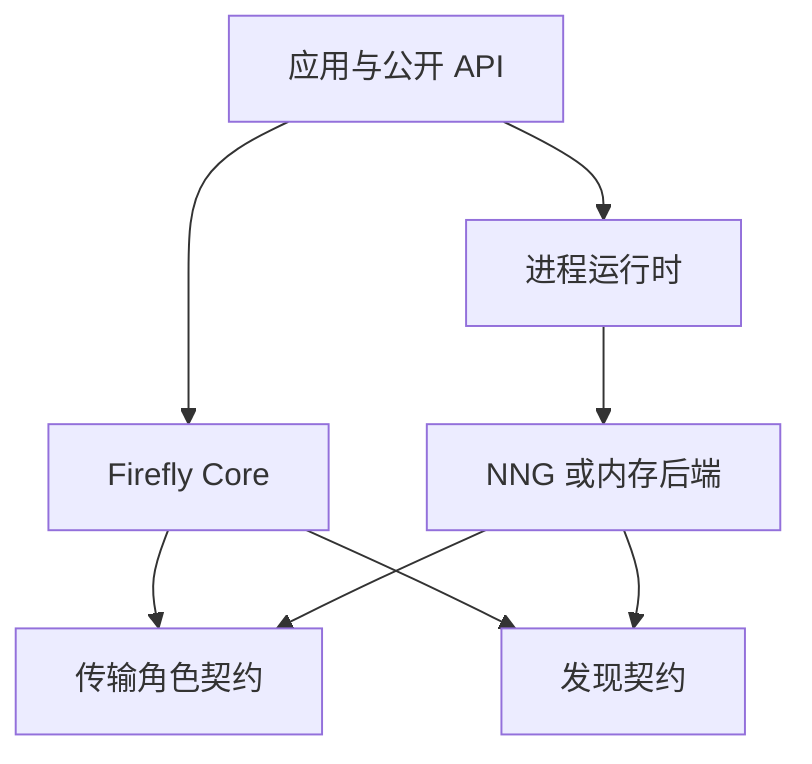

# 架构概览

Firefly 是面向进程间组件通信的 C++17 库。应用用 Protobuf 类型声明通道和服务，Core 统一提供发布订阅、请求应答与端点生命周期；适配器提供具体的数据传输与端点发现。默认 NNG 组合用于同机跨进程通信，内存组合用于进程内通信、契约测试与无 NNG 构建。

本文将「现在是什么」压成一页；行为细节见 [contracts.md](contracts.md)，模块与依赖见 [modules.md](modules.md)，尚未闭合的约束见 [known-gaps.md](known-gaps.md)。

## 1. 分层

箭头表示调用、实现或组装所依赖的对象。`Runtime → Backend` 通过内部注入入口选择实现。发现返回逻辑记录，传输解释具体地址。

## 2. 决策摘要

| 决策 | 代价 / 边界 | 记录 |
| --- | --- | --- |
| 公共接口用 Protobuf 类型表达消息，Core 与后端一律以字节处理 | 调用方获得类型化 API，Core 与具体消息类解耦。通信两端仍需自行保持消息 schema 兼容 | [ADR-0002](../decisions/0002-split-transport-and-discovery-contracts.md) |
| 传输与发现分别注入 | 同一发现实现可被不同传输配置复用，也可分别替换与测试。跨后端部署需在发现记录中标识兼容的数据平面 | [ADR-0002](../decisions/0002-split-transport-and-discovery-contracts.md) |
| 传输按四种通信角色建模（发布/订阅/请求/应答） | Core 直接表达四类需求；适配器自行管理 socket、连接与协议状态，并承担与 Firefly 语义之间的转换 | [ADR-0003](../decisions/0003-four-role-transport-interfaces.md) |
| 每 Client 单 I/O 执行者，每 Reader 与 Service 串行处理 | 请求关联与回调顺序由单端点定义。慢请求阻塞同一 Client 的后续请求，慢回调延后同一端点的下一条消息；不同端点并行 | [ADR-0005](../decisions/0005-single-io-executor-per-client.md) |
| 默认后端由链接配置选定 | 应用使用同一公开入口，测试可显式构造多个后端实例；每个链接产物只包含一套同名的默认注入符号 | [ADR-0003](../decisions/0003-four-role-transport-interfaces.md) |
| 发现层用 `EndpointRecord` 记录模型，按 `id` 注销 | 同键多记录、Reader 无地址也能独立登记；代价是发现侧协议需要携带可选 `id`/`backend` 字段 | [ADR-0004](../decisions/0004-endpoint-record-discovery-model.md) |
| 不引入第三套生产后端（ZeroMQ） | 第二后端已证明传输可替换；第三后端只带来部署面收益与永久翻倍维护成本 | [ADR-0006](../decisions/0006-no-third-backend-zmq.md) |

## 3. 术语表

本文档集统一使用下列术语，其它文档不再另立说法。

| 术语 | 含义 |
| --- | --- |
| 端点 | 应用可见的通信对象：`Writer`、`Reader`、`Service`、`Client`。由 `Node` 创建 |
| Core | 端点的行为实现（`src/core/*_core.cc`），负责准人、缓存、队列、回调派发、错误映射与资源释放 |
| 角色 | 传输层四个接口：`Publisher`、`Subscriber`、`RpcRequester`、`RpcResponder` |
| 后端 | 角色与发现接口的一套具体实现（当前为 `nng` 与 `memory`） |
| 注入 | 通过 `InjectionContext` 把工厂与 Registry 交给 Core；缺省字段由默认注入补齐 |
| 发现记录 | `EndpointRecord{id, kind, name, backend, address}`，发现层的唯一数据单位 |
| Watch | 订阅某 `kind+name` 的变更，收到一致初始快照与后续完整快照 |
| 发送语义 | `Write` 的受理结果：`kAccepted` 只表示交给本地传输层，不代表对端收到 |
| 绝对截止时间 | `Deadline`（`steady_clock::time_point`）；排队、查询、连接、收发共用一份预算 |
| FFRP | RPC 响应帧格式：`"FFRP"` + 32 位状态 + 响应载荷 |
| Observe 模式 | Reader 缓存最近 `depth` 条消息供轮询读取，而非回调派发 |

## 4. 阅读顺序

1. 新读者：[README](../../README.md) → 本文 → [contracts.md](contracts.md)。
2. 要改代码：[modules.md](modules.md) → 相关 ADR → [guides/build.md](../guides/build.md)。
3. 要判断「能不能这样改」：[contracts.md](contracts.md) 与 [known-gaps.md](known-gaps.md) 是权威；ADR 只解释理由，不描述现状。
